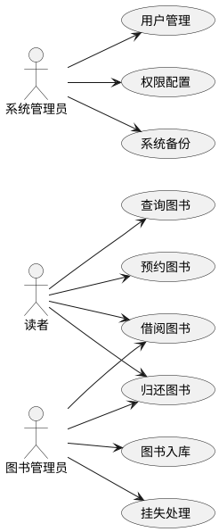
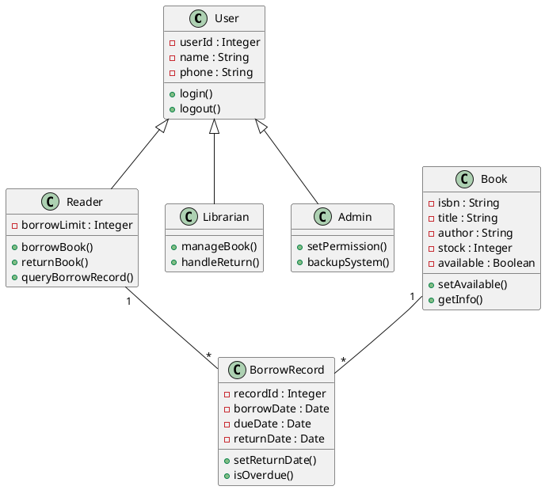
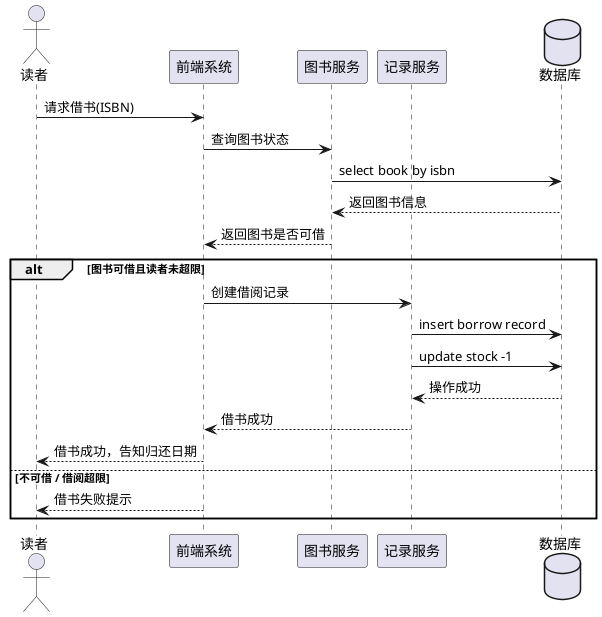
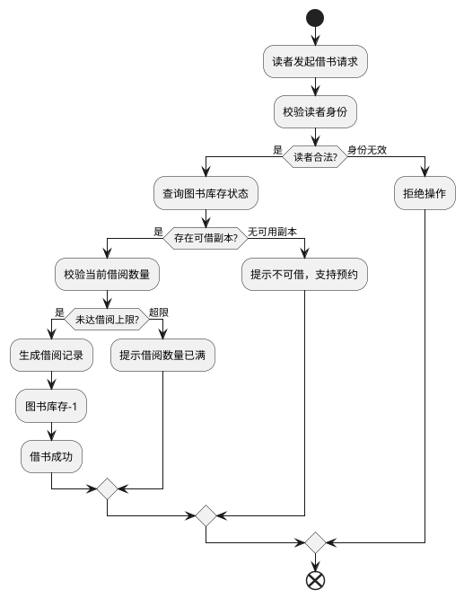
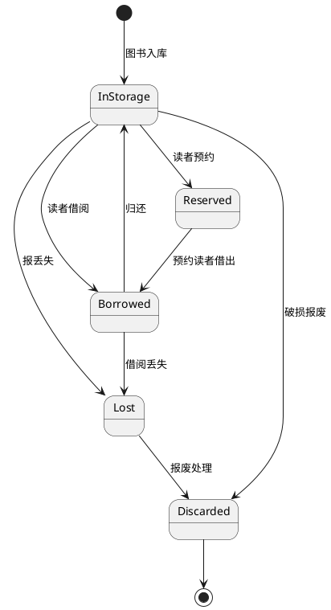

# 对 “修改昵称” 用例的完整描述（群报数小程序）

参与者：小程序用户（主要参与者），群报数后台系统（次要参与者）
目标：用户在群报数小程序修改个人昵称
范围：群报数小程序系统
前置条件：用户已经登录群报数小程序
后置事件：用户昵称信息更新成功，系统保存用户资料修改记录

## 主事件流

1. 用户点击【我的】，系统加载并展示个人中心页面
2. 用户点击头像 / 昵称区域，系统进入个人资料编辑页面
3. 用户选中昵称栏，输入新昵称
4. 用户点击完成按钮，系统校验新昵称格式合规性
5. 系统向群报数后台提交昵称修改请求，更新用户昵称数据
6. 系统返回修改成功提示，刷新个人资料页面展示新昵称

## 备选事件流

1a：用户未登录

1. 系统跳转登录页面，用例结束

3a：新昵称输入为空

1. 系统提示昵称不能为空，停留在编辑页面，返回步骤 3

4a：新昵称包含违规敏感内容

1. 系统提示昵称含有违规内容，请重新输入，返回步骤 3

4b：新昵称长度超出限制

1. 系统提示昵称长度不符合要求，返回步骤 3

5a：网络异常，无法连接后台

1. 系统提示网络错误，修改失败，停留在编辑页面

5b：后台服务器异常

1. 系统提示修改失败，请稍后重试，用例结束

发生频率：按需触发


# 图书馆管理系统 UML 全套图

> 说明：以下所有图均使用 **PlantUML（Legacy UML）语法**，用 ```plantuml 代码块包裹，可直接复制到 Markdown 文件，在支持 PlantUML 的编辑器（VSCode PlantUML 插件、Obsidian PlantUML、Typora 插件）或在线工具（https://www.planttext.com/ ）中渲染。
>
> 共 9 张图：用例图、类图、对象图、时序图、活动图、状态图、时间图、组件图、部署图。

---

## 1. Use case diagram 用例图




---


## 2. Class diagram 类图




---

## 3. Object diagram 对象图


```plantuml
@startuml 对象图
object R1 : Reader {
    userId = 1001
    name = 张三
    borrowLimit = 5
}

object B1 : Book {
    isbn = 9780001
    title = 数据结构
    stock = 3
    available = true
}

object REC1 : BorrowRecord {
    recordId = 5001
    borrowDate = 2026-10-01
    dueDate = 2026-10-31
    returnDate = null
}

R1 -- REC1
B1 -- REC1
@enduml
```

---

## 4. Sequence diagram 时序图（借书流程）




---

## 5. Activity diagram 活动图（借书流程）




---

## 6. State diagram 状态图（图书生命周期）




---

## 7. Timing diagram 时间图


```plantuml
@startuml 图书时间图
robust "图书A" as BA
BA is InStorage @0
BA is Borrowed @2
BA is InStorage @12
BA is Reserved @15
BA is Borrowed @20
BA is InStorage @30
@enduml
```

---

## 8. Component diagram 组件图


```plantuml
@startuml 组件图
component WebFrontend [前端页面]
component AuthModule [认证模块]
component BookModule [图书管理模块]
component BorrowModule [借阅模块]
component UserModule [用户模块]
component DBModule [数据库访问组件]
database LibraryDB [图书馆数据库]

WebFrontend --> AuthModule
WebFrontend --> BookModule
WebFrontend --> BorrowModule
WebFrontend --> UserModule

AuthModule --> DBModule
BookModule --> DBModule
BorrowModule --> DBModule
UserModule --> DBModule

DBModule --> LibraryDB
@enduml
```

---

## 9. Deployment diagram 部署图


```plantuml
@startuml 部署图
node ClientPC [读者电脑]
node ClientPhone [手机端]
node WebServer [Web应用服务器]
node DBServer [数据库服务器]

ClientPC --> WebServer : HTTPS
ClientPhone --> WebServer : HTTPS
WebServer --> DBServer : JDBC

WebServer : 部署：前端、业务组件
DBServer : 部署：MySQL数据库
@enduml
```
